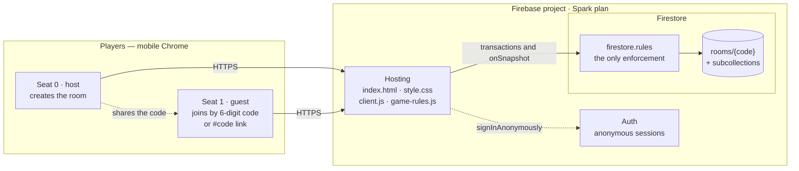
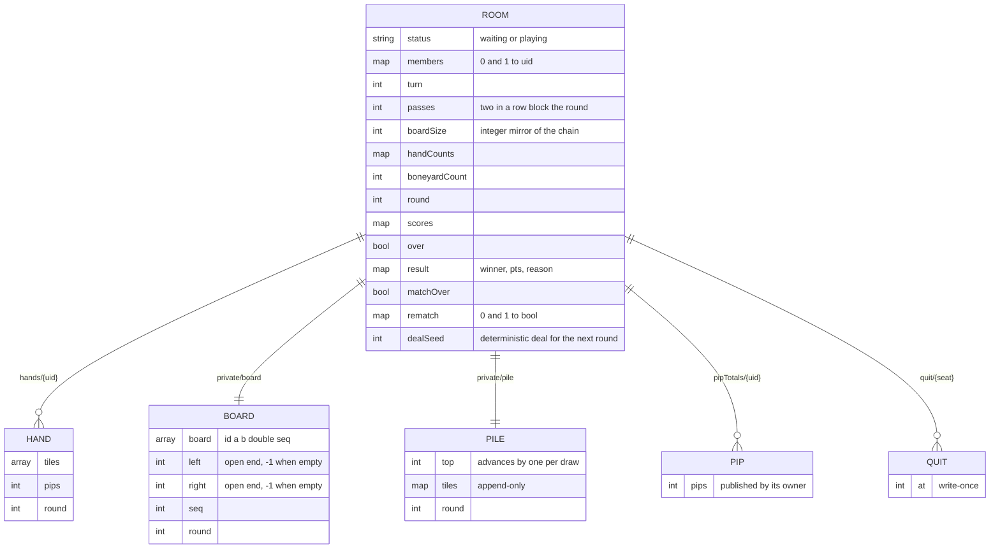
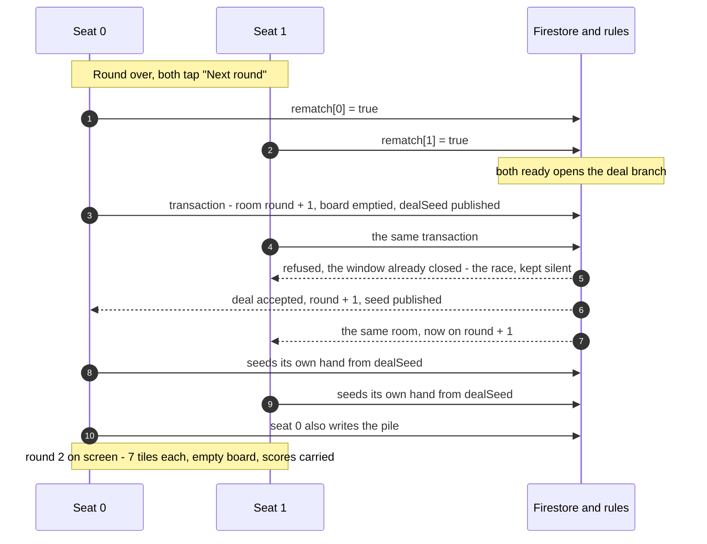

# Architecture

Two players, one Firestore room, no server. The Spark plan has no Cloud
Functions, so **`firestore.rules` is the only thing enforcing the game** — the
client is untrusted, and every move, score and quit is checked server-side.

## What runs where

`public/game-rules.js` is pure — no I/O — and is imported by the browser client.
It holds the deal, the tile matching, drawing, passing and scoring, so the rules
on the client and the rules in `firestore.rules` describe the same game.

## Data model

One room document per table, plus a subcollection per player-owned or hidden
thing. Every collection below is guarded by its own rule.

The tile chain lives in its own document on purpose. When it lived in the room,
every write to the room was charged for comparing tile arrays — set membership
over up to 28 tiles — and the rules engine refuses anything needing more than
1000 expressions. It fails closed, so the next-round deal, which never touches
the board, was refused exactly as if it were a cheat. `boardSize` in the room is
the cheap integer that keeps the two documents tied together: a move has to bump
both.

## What each rule allows

| Transition | Guarded on | Branch |
| --- | --- | --- |
| Host opens a table | `rooms/{code}` create | create |
| Guest joins and deals round 1 | room, hands, pile, board | A |
| Play a tile | room: `boardSize + 1`, hand `- 1`, turn flips · board: one tile appended | B |
| Draw from the pile | hand `+ 1`, pile top `+ 1` | C |
| Pass | turn flips, `passes + 1` | D |
| Second pass blocks the round | `over = true`, unsettled | E |
| Settle a closed round | points must match the loser's own hand document | F |
| Tick "ready" for the next round | own seat only, write-once | G |
| Deal the next round | both seats ready, `round + 1`, scores carried | H |
| Seed my own hand for the new round | my hand's round is stale | hands |
| Quit | own seat, write-once, allowed while waiting | quit |

## The next round

The deal is the subtlest flow in the project: it is a race between two clients,
and neither may write the other's hand.

Each client seeds its own hand from `dealSeed`, because the rules only ever let
you write your own hand. A consequence worth knowing: the deal is deterministic
from that seed, so a player watching the room document could predict the tiles.
Fine between friends, not between strangers.

## Superseded

`server.js` (Express + `ws`) and `public/client-ws.js` are the original
in-memory WebSocket version. `test/playthrough.js` and `test/rules.js` drive real
WebSocket clients against that server and do not test the live Firestore game;
`npm test` still runs them. `Dockerfile` and `deploy.sh` are the Cloud Run path.
